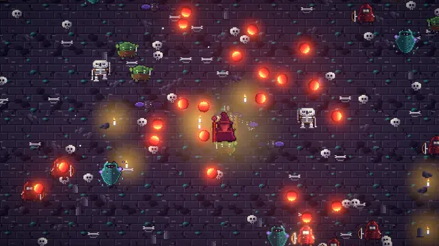
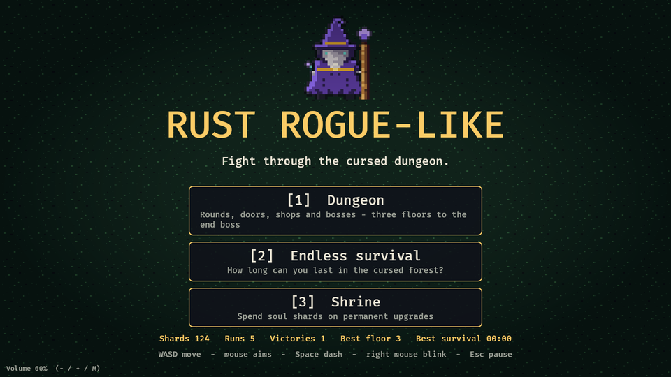
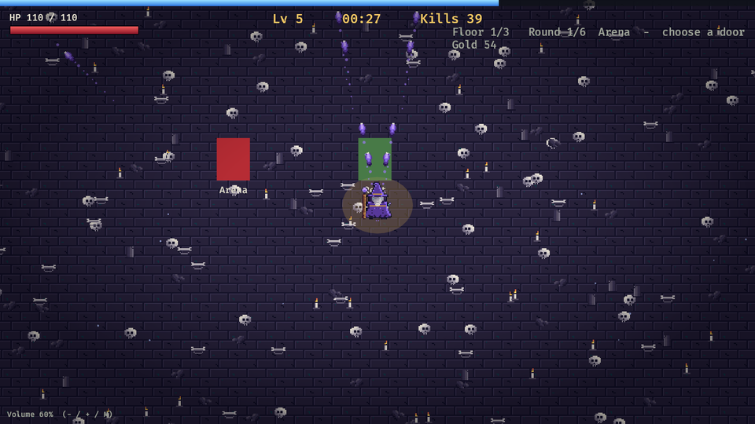
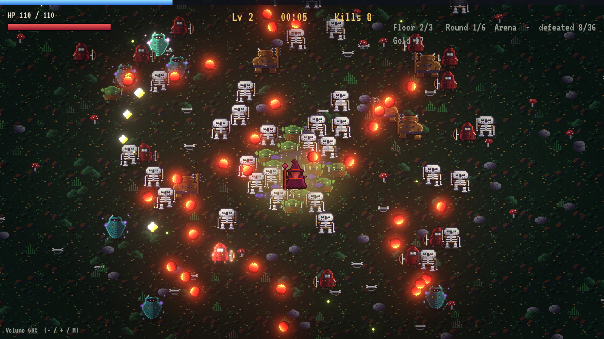
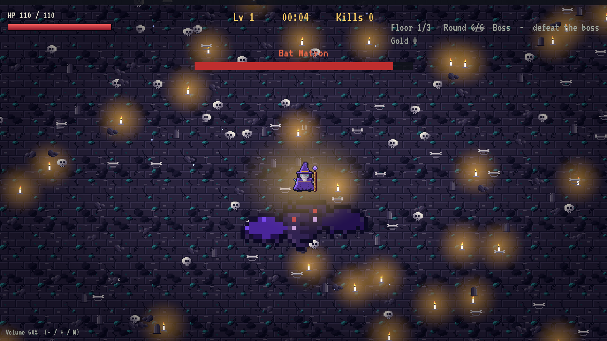
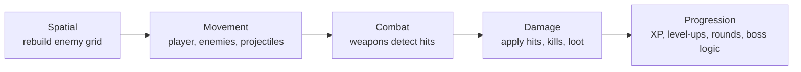

# Hexfall

A dark-fantasy **survivor-roguelike** written in **Rust** with the
**[Bevy](https://bevy.org) 0.20** engine. You are a lone wizard: your spells cast themselves
towards the mouse cursor, your job is to move, dodge and turn lucky upgrade rolls into a build
that survives three floors of rounds, shops and bosses - and the end boss.

<p align="center">
  
</p>

**[▶ Play in the browser](https://MichaelRimland.github.io/rust-rogue-like/)**

| | |
| --- | --- |
|  |  |
|  |  |

## Features

- **Two modes.** A **Dungeon** of three floors in a large arena: fight rounds, pick a door
  (elite round, shop, treasure, rest), beat a different boss on every floor and finally
  *The Hollow King*. Or the original **Endless** survival mode.
- **Builds out of luck.** Every level-up offers three of 33 upgrades. Movement skills (Dash,
  Blink), spell modifiers (Fork, Chain, Spell Echo, Impact Burst, Searing Touch, Returning
  Bolts, Surpassing Chance, Seeking Bolts, Precision, Frostbite, Concussive Force, Shock,
  Magnified Bolts, extra projectiles, piercing), passives (Soul Drain, Bloodrage) and two more
  weapons (Thunderstorm, Frost Nova) are never given upfront, and every pick levels up when
  it is rolled again.
- **Weapon evolutions.** Max out the right ingredients and a spell fuses into something new
  (Sanctum, Prism Bolt, Arcane Tempest).
- **Six enemy types, five bosses.** Ranged enemies shoot slow bolts you have to dodge; bosses
  fire bolt rings, aimed fans and spirals, summon helpers, charge, and get nastier in phases.
- **Three worlds** (forest, crypt, inferno) with their own ground, decoration and mood,
  lit with HDR bloom, light pools and soft shadows.
- **Meta-progression.** Runs earn soul shards that buy permanent bonuses at the shrine;
  records are saved.
- **Seeded runs.** Every run is driven by one seed (shown on the game over screen).
- Runs natively (Windows, macOS, Linux) and in the browser via WebAssembly.

## Controls

| Key | Action |
| --- | --- |
| `WASD` / arrow keys | Move |
| Mouse | Aim the Arcane Missile (it fires automatically) |
| `Space` | Dash: short burst, invulnerable while dashing (unlocked via level-up) |
| Right mouse button | Blink: teleport towards the cursor (unlocked via level-up) |
| `1` `2` `3` or mouse click | Choose an upgrade; in the main menu: Dungeon, Endless, Shrine |
| `Esc` / `P` | Pause |
| `-` `+` / `M` | Volume down / up / mute |

In the dungeon, walk into a door after a round is cleared to continue; in a shop, walk onto an
item to buy it.

## Technical highlights

- **Plugin-per-feature ECS architecture** with explicitly ordered system sets
  (`Spatial -> Movement -> Combat -> Damage -> Progression`).
- **Engine-independent rules.** Stats, upgrades, difficulty curves, floor plans, boss
  patterns, the spatial hash and the RNG live in `src/logic/` without any Bevy dependency
  and are covered by unit tests (57 tests).
- **Performance by design.** Hit tests and steering query a spatial hash grid that is
  rebuilt every frame; 5 000 enemies run at 70+ FPS, with shadows, light pools and bloom (see [Performance](#performance)).
- **Data-driven enemies.** Stats and spawn rules are in `assets/data/enemies.ron`,
  embedded at compile time (works in the browser) and guarded by a test.
- **Deterministic runs.** A SplitMix64 RNG replaces the `rand` crate; the seed is shown on
  the game over screen, and purely cosmetic effects use their own RNG so they never change
  how a seed plays out.
- **Built-in autoplay bot.** `--autoplay` plays unattended runs, prints frame-time statistics
  and doubles as an end-to-end smoke test; it can also capture screenshots and frame
  sequences (the animation above was recorded with it).
- **Reproducible assets.** Sprites are drawn from character grids with a fixed 32-colour
  palette (`tools/draw_sprites.py`), the sounds are synthesized (`tools/make_sounds.py`);
  AI-generated art can be dropped in and fitted to the palette (`tools/process_sprites.py`).
- **CI.** Format, Clippy (`-D warnings`), tests, WASM build, Pages deploy and a Windows
  release workflow.

## Building

Requires Rust **1.97.1** or newer (`rustup update`).

```bash
cargo run                  # first build takes a few minutes, Bevy is big
cargo run --features dev   # faster incremental builds (dynamic linking)
cargo test
cargo build --release
```

On Linux you need a few system packages first, e.g. on Ubuntu:
`sudo apt install g++ pkg-config libx11-dev libasound2-dev libudev-dev libxkbcommon-x11-0 libwayland-dev libxkbcommon-dev`.

### Web build

```bash
rustup target add wasm32-unknown-unknown
cargo build --profile wasm-release --target wasm32-unknown-unknown
cargo install wasm-bindgen-cli   # version must match the wasm-bindgen crate in Cargo.lock
wasm-bindgen --out-dir dist --out-name hexfall --target web --no-typescript \
  target/wasm32-unknown-unknown/wasm-release/hexfall.wasm
cp web/index.html dist/ && cp -r assets dist/
# serve dist/ with any static file server, e.g. `python3 -m http.server -d dist`
```

The deploy workflow (`.github/workflows/deploy.yml`) does exactly this and publishes to GitHub
Pages.

## Tools

| Command | What it does |
| --- | --- |
| `cargo run -- --autoplay 30` | Unattended bot run; prints frame-time statistics and exits |
| `cargo run -- --autoplay 30 --enemies 5000 --endless` | Benchmark with a crowd |
| `cargo run -- --autoplay 30 --floor 3 --boss` | Jump straight into a boss room |
| `cargo run -- --autoplay 30 --maxed` | Start with every upgrade at maximum |
| `cargo run --release -- --autoplay 300 --mortal` | Let the bot die; prints time, level and kills (balancing) |
| `cargo run -- --autoplay 30 --room shop` | Start in a shop, rest, treasure or elite room |
| `cargo run -- --autoplay 40 --capture-dir frames --capture-from 20` | Save a frame sequence |
| `python tools/make_gif.py frames docs/gameplay.webp` | Assemble frames into an animation |
| `python tools/draw_sprites.py` | Redraw all sprites (fixed palette) |
| `python tools/make_sounds.py` | Synthesize the sound effects and the ambient loop |
| `python tools/process_sprites.py` | Fit AI-generated art to the sprite size and palette |

## Architecture

The game follows Bevy's ECS architecture with **one plugin per feature**. Rules that do not
need the engine live in `logic/`, so they can be unit tested without a window, GPU or ECS world.

```
src/
├── main.rs           window setup, adds GamePlugin
├── lib.rs            GamePlugin, system set ordering (GameSet)
├── states.rs         AppState (menu / in game / game over / shrine) + GamePhase sub-state
├── run.rs            per-run resources: seed, RNG, stats, timer, pause
├── dungeon.rs        dungeon mode: rounds, doors, shop, treasure, bosses
├── enemy.rs          spawning, steering with separation, spatial grid, status effects
├── enemy_fire.rs     projectiles shot by ranged enemies and bosses
├── weapons.rs        Arcane Missile and its modifiers, Aura, Runes, Thunderstorm, Frost Nova
├── combat.rs         damage messages, kills, loot, particles, contact damage
├── skills.rs         movement skills: dash and blink
├── player.rs         movement, health, regeneration, death
├── progression.rs    XP gems, level-ups, upgrade selection
├── world.rs          camera, tiled ground, biomes, ambient particles
├── save.rs           save game and meta-progression
├── audio.rs          sound effects, ambient loop, volume
├── assets.rs         sprite handles and shared meshes/materials
├── animation.rs      two-frame walk cycles
├── bench.rs          performance overlay (F3) and enemy burst (F4)
├── autoplay.rs       unattended bot runs, benchmarks, screenshots
├── ui/               HUD, menus, level-up screen, vignette and biome tint
└── logic/            engine-independent and unit tested
    ├── spatial.rs    uniform spatial hash grid
    ├── stats.rs      player stats, upgrades, evolutions, upgrade rolling
    ├── progression.rs XP curve and difficulty curves
    ├── enemies.rs    enemy archetypes (loaded from RON) and spawn rules
    ├── dungeon.rs    floor plans, rounds, biomes, boss patterns
    ├── skills.rs     cooldowns and dash/blink geometry
    ├── meta.rs       shrine upgrades, records, shards
    └── rng.rs        deterministic SplitMix64 RNG
```

### Frame order

Gameplay systems run in explicitly ordered sets, and only while the game is in
`GamePhase::Running` (level-up and pause simply stop them, no special casing needed):



### Design decisions

- **Spatial hash grid instead of a physics engine.** All hit tests (missiles, aura, runes,
  contact damage, enemy separation) query a grid that is rebuilt every frame. Cost per query
  stays roughly constant regardless of enemy count, and no physics engine is needed for what
  is circle-vs-circle overlap.
- **Damage via messages.** Weapons only write `DamageEnemy` messages; one system applies
  them. Kill handling (loot, particles, statistics, soul drain) lives in a single place, and a
  new weapon needs no knowledge of what happens on death.
- **Upgrades are data plus a match.** Each upgrade is an `Upgrade` variant with levels and
  caps in `logic/stats.rs`; weapons read derived values (`fork_count()`, `slow_factor()`, ...),
  so balance changes never touch the combat code.
- **States drive the game flow.** Entities carry `DespawnOnExit(..)`, so leaving a run cleans
  everything up and restarting is just entering `AppState::InGame` again.
- **Sound and visuals are decoupled from gameplay.** Gameplay writes `PlaySound` messages;
  ambient particles use a cosmetic RNG so a seed always plays out the same way.

## Performance

Measured with the built-in benchmark (`cargo run -- --autoplay 15 --endless --enemies N`, dev
profile with optimized dependencies, Ryzen 5 7600X, RX 7900 XT, 1280x720; a bot walks around
and picks upgrades):

| Enemies alive | Avg frame time | FPS | p99 frame time |
| ---: | ---: | ---: | ---: |
| 1 000 | 3.6 ms | 280 (display limit) | 4 ms |
| 5 000 | 13.6 ms | 74 | 21 ms |
| 10 000 | 16.3 ms | 61 | 26 ms |

The crowd contains every enemy type, including ranged ones and all their bolts, with sound,
damage numbers, soft shadows under every enemy, light pools and bloom switched on. The target of 5 000 enemies at 60 FPS is met with a wide margin. Browser
(WASM) performance has not been measured yet.

## Status

Milestones 1-5 (core loop, performance, dungeon, content, polish) are done. Ideas that are not
implemented: weapons defined in data files, gamepad support, more bosses and biomes, an
options menu, a real art pass.

## Development with AI

This project was built together with an AI coding assistant (Claude Code): it wrote a large
part of the code, tests, tools and documentation under my direction. Design decisions,
playtesting, balancing and review are mine. The commit history shows the assistant as
co-author. Sprites are drawn in code and sounds are synthesized, so there are no third-party
assets and no licensing questions.

## License

MIT, see [LICENSE](LICENSE).
