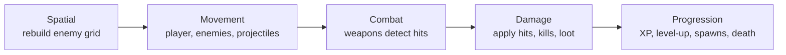

# rust-rogue-like

*(Working title.)* A fantasy survivor-roguelike written in **Rust** with the **[Bevy](https://bevy.org) 0.20** game engine.
You are a lone wizard in a cursed forest. Your spells cast themselves; your job is to move,
aim with the mouse, survive the ever-growing hordes, and combine upgrades into a build that can outlast the night.

<!-- TODO once the repo is public and GitHub Pages is enabled, restore the play link:
**[▶ Play in the browser](https://MichaelRimland.github.io/rust-rogue-like/)**
-->

<!-- Add a GIF here once the game runs: docs/gameplay.gif -->

## Features

- **Survivor-style combat** with hundreds of enemies on screen at once
- **Three spells** that stack into builds: Arcane Missile (fires automatically towards the mouse cursor, piercing volleys),
  Holy Aura (damage field) and Orbiting Runes
- **Weapon evolutions**: max out the right ingredients and a spell fuses into something new
  (Sanctum, Prism Bolt, Arcane Tempest)
- **Level-up choices**: pick one of three rolled upgrades, weapons and passives with caps.
  Movement skills (Dash, Blink) and spell modifiers (Fork, Chain, Spell Echo, Impact Burst,
  Searing Touch, extra projectiles, piercing) are
  not given upfront: you need luck on the roll, and every pick can be levelled by rolling it again
- **Difficulty that scales over time**: faster waves, new enemy types (goblins, skeletons, ogres, bats, archers and warlocks whose bolts you have to dodge), tougher monsters
- **Two modes**: a **Dungeon** of three floors with rooms, door choices, shops, treasure and
  bosses, and the original **Endless** survival mode
- **Meta-progression**: runs earn soul shards that buy permanent bonuses at the shrine
- **Seeded runs**: every run is driven by one seed shown on the game over screen
- Runs natively (Windows, macOS, Linux) and in the browser via WebAssembly

## Controls

| Key | Action |
| --- | --- |
| `WASD` / arrow keys | Move |
| Mouse | Aim the Arcane Missile (it fires automatically) |
| `Space` | Dash: short burst in the movement direction, invulnerable while dashing (unlocked via level-up) |
| Right mouse button | Blink: teleport towards the cursor, limited range (unlocked via level-up) |
| `1` `2` `3` | Choose an upgrade |
| `Esc` / `P` | Pause |
| `Enter` / `Space` | Start / restart |

## Building

Requires Rust **1.97.1** or newer (`rustup update`).

```bash
# Run the game (first build takes a few minutes, Bevy is big)
cargo run

# Faster incremental builds while developing (dynamic linking, dev tools)
cargo run --features dev

# Unit tests
cargo test

# Optimized native build
cargo build --release
```

On Linux you need a few system packages first, e.g. on Ubuntu:
`sudo apt install g++ pkg-config libx11-dev libasound2-dev libudev-dev libxkbcommon-x11-0 libwayland-dev libxkbcommon-dev`.

### Web build

```bash
rustup target add wasm32-unknown-unknown
cargo build --profile wasm-release --target wasm32-unknown-unknown
cargo install wasm-bindgen-cli   # version must match the wasm-bindgen crate in Cargo.lock
wasm-bindgen --out-dir dist --out-name rust_rogue_like --target web --no-typescript \
  target/wasm32-unknown-unknown/wasm-release/rust-rogue-like.wasm
cp web/index.html dist/
# serve dist/ with any static file server, e.g. `python3 -m http.server -d dist`
```

Pushing to `main` builds and deploys this automatically to GitHub Pages (see `.github/workflows/deploy.yml`).

## Architecture

The game follows Bevy's ECS architecture with **one plugin per feature**. Rules that do not need
the engine live in a separate, engine-independent `logic` module so they can be unit tested
without a window, GPU or ECS world.

```
src/
├── main.rs           window setup, adds GamePlugin
├── lib.rs            GamePlugin, system set ordering (GameSet)
├── states.rs         AppState (menu / in game / game over) + GamePhase sub-state
├── run.rs            per-run resources: seed, RNG, stats, timer, pause
├── audio.rs          sound effects, ambient loop, volume
├── assets.rs         sprite handles and shared meshes/materials
├── animation.rs      two-frame walk cycles
├── world.rs          camera follow, endlessly wrapping forest decoration
├── player.rs         movement, health, regeneration, death
├── skills.rs         movement skills: dash and blink
├── save.rs           save game and meta-progression
├── dungeon.rs        dungeon mode: rooms, doors, shop, treasure, boss
├── enemy.rs          spawning, steering with separation, spatial grid
├── enemy_fire.rs     projectiles shot by ranged enemies
├── weapons.rs        Arcane Missile, Holy Aura, Orbiting Runes
├── combat.rs         damage messages, kills, loot, particles, contact damage
├── progression.rs    XP gems, level-ups, upgrade selection
├── ui/               HUD, menus, level-up screen
└── logic/            engine-independent and unit tested
    ├── spatial.rs    uniform spatial hash grid
    ├── stats.rs      player stats, upgrades, upgrade rolling
    ├── progression.rs XP curve and difficulty curves
    ├── enemies.rs    enemy archetypes and spawn tables
    ├── meta.rs       shrine upgrades, records, shards
    ├── dungeon.rs    floor plans, wave sizes, difficulty per room
    └── rng.rs        deterministic SplitMix64 RNG
```

### Frame order

Gameplay systems run in explicitly ordered sets, and only while the game is in `GamePhase::Running`
(level-up and pause simply stop them, no special casing needed):



### Design decisions

- **Spatial hash grid instead of a physics engine.** All hit tests (missiles, aura, runes,
  contact damage, enemy separation) query a grid that is rebuilt every frame. That keeps the
  cost per query roughly constant regardless of enemy count, and avoids pulling in a full
  physics engine for what is circle-vs-circle overlap.
- **Damage via messages.** Weapons only write `DamageEnemy` messages; one system applies them.
  Kill handling (loot, particles, statistics) lives in a single place, and new weapons need no
  knowledge of what happens on death.
- **States drive the game flow.** Entities are tagged with `DespawnOnExit(..)`, so leaving a
  run cleans everything up automatically, and restarting is just entering `AppState::InGame` again.
- **Deterministic RNG.** A tiny SplitMix64 generator replaces the `rand` crate: no extra
  dependency, works identically on native and WASM, and makes runs reproducible from their seed.

## Performance

Every enemy, projectile and hit test goes through a spatial hash grid, so the cost per
query does not grow with the crowd. Measured with the built-in benchmark
(`cargo run -- --autoplay 15 --enemies N`, dev profile with optimized dependencies,
Ryzen 5 7600X, RX 7900 XT, 1280x720; the bot walks around and picks upgrades):

| Enemies alive | Avg frame time | FPS | p99 frame time |
| ---: | ---: | ---: | ---: |
| 1 000 | 3.6 ms | 280 | 4.0 ms |
| 5 000 | 4.3 ms | 233 | 8.2 ms |
| 10 000 | 9.6 ms | 105 | 19.6 ms |
| 20 000 | 23.7 ms | 42 | 41.6 ms |

The target of 5 000 enemies at 60 FPS is met with a wide margin. The in-game overlay
(`F3`) and enemy burst (`F4`) show the same numbers interactively. Browser (WASM) performance
is not measured yet.

## Roadmap

- [x] **Milestone 1: core loop** — movement, auto-attacks, enemies, XP, level-ups, game over
- [x] **Milestone 2: performance** — benchmark mode, measured 5 000 enemies at 230 FPS (see above)
- [x] **Milestone 3: dungeon** — three floors of procedurally generated rooms (arenas, elites, shops, treasure, rest), doors that open after the fight, a boss at the end of each floor
- [x] **Milestone 4: content** — data-driven enemies (RON), weapon evolutions, six enemy types, a different boss on every floor
- [x] **Milestone 5: polish** — pixel-art sprites, synthesized sound, screen shake, damage numbers, shrine meta-progression with a save game, Windows release workflow

## Development with AI

This project is developed with the help of an AI coding assistant, which I use for boilerplate,
first drafts of systems and keeping documentation up to date. Architecture, game design,
review and testing are my own work.

## License

MIT, see [LICENSE](LICENSE).
